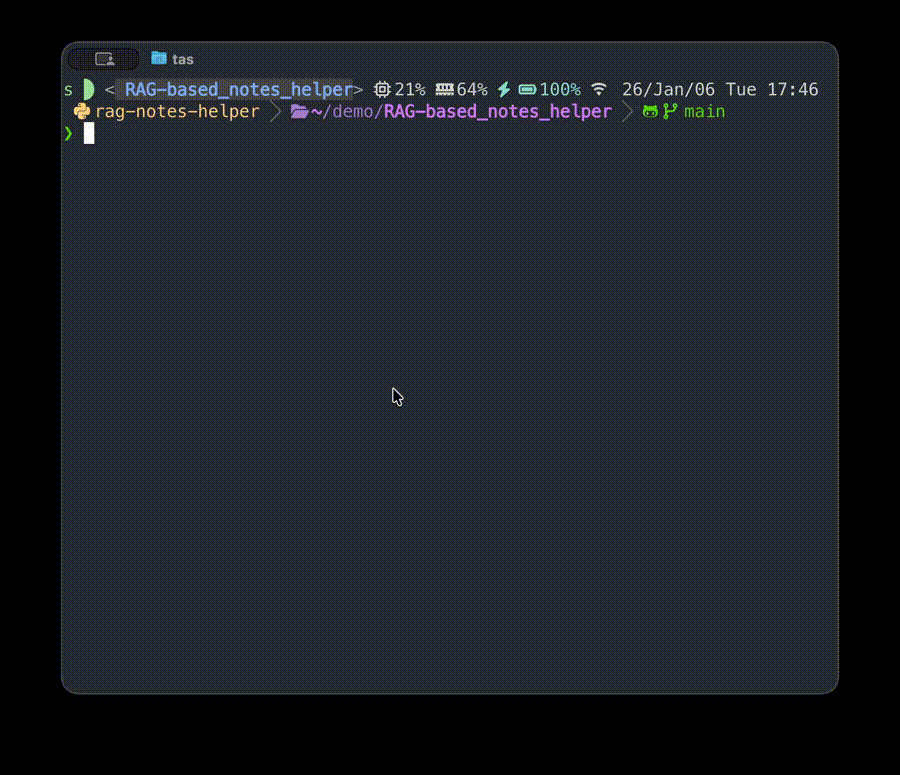
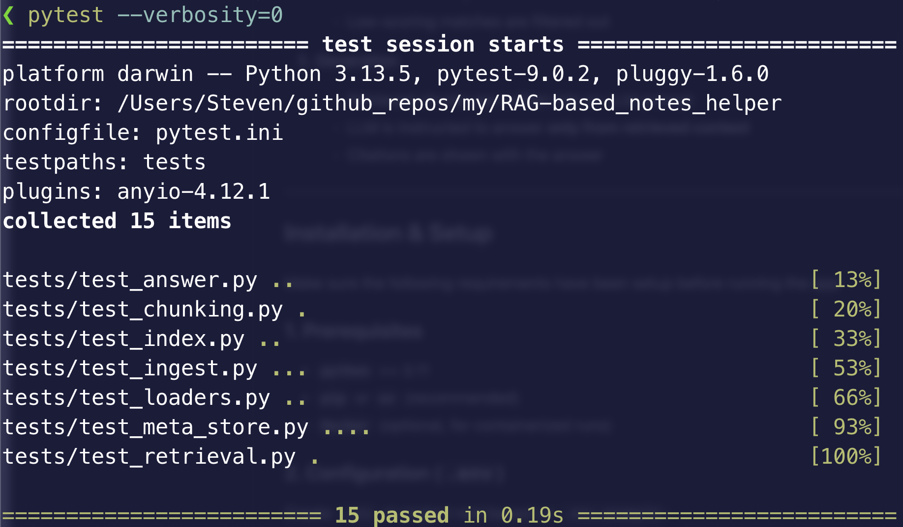

# RAG-based Notes Helper


A local-first Retrieval-Augmented Generation (RAG) application for querying personal notes and documents. The system indexes notes with SentenceTransformer embeddings and FAISS, combines Vector and BM25 search results with Reciprocal Rank Fusion, and sends grounded context to a configurable LLM backend.

The application can run from source or as a containerized CLI. It supports Classic RAG by default and an opt-in Agentic RAG workflow, one-time queries, an interactive REPL, source citations, smart re-indexing, multiple LLM providers, PDF ingestion, and a fixture-backed RAGAS benchmark.

<p align="center">
    <a href="docs/demo.mp4">
        
    </a>
</p>

---

## Contents

- [Why RAG for Notes](#why-rag-for-notes)
- [Features](#features)
- [Architecture](#architecture)
- [How It Works](#how-it-works)
- [Evaluation](#evaluation)
- [Tech Stack](#tech-stack)
- [Project Structure](#project-structure)
- [Local Development](#local-development)
- [Usage](#usage)
- [Docker Usage](#docker-usage)
- [Configuration](#configuration)
- [Testing](#testing)
- [CI/CD](#cicd)
- [Limitations](#limitations)
- [Future Work](#future-work)
- [License](#license)

---

## Why RAG for Notes

A note assistant should answer from the current knowledge base without requiring model fine-tuning every time the notes change.

Fine-tuning is usually a poor fit for personal notes because:

- knowledge updates require additional training runs
- model behavior becomes harder to debug and reproduce
- private notes may be mixed into model weights
- hallucination sources are harder to inspect
- infrastructure cost increases for a problem that can be solved with retrieval

This project keeps knowledge external and inspectable. Notes are chunked, embedded, indexed, retrieved at query time, and passed to the LLM as explicit context.

---

## Features

### Retrieval pipeline

- Ingests `.txt`, `.md`, `.pdf`, and `.py` files from `data/`.
- Splits documents into overlapping chunks with configurable chunk size and overlap.
- Generates local embeddings with SentenceTransformer.
- Stores vectors in FAISS for similarity search.
- Combines Vector and BM25 candidate rankings with Reciprocal Rank Fusion (RRF).
- Stores chunk metadata separately in JSONL with an offset index for efficient lookup.
- Supports smart indexing so unchanged files do not need to be reprocessed.

### Generation

- Supports multiple LLM backends:
  - Hugging Face Inference API
  - Google Gemini
  - OpenAI
  - OpenRouter
  - Ollama for local inference
- Grounds answers in retrieved context.
- Offers an opt-in Agentic RAG workflow with up to three Search attempts and three evidence-reviewed Answer attempts per query.
- Supports optional citation output for source visibility.
- Supports streaming responses in REPL mode.

### CLI workflow

- One-time query mode for shell usage and scripting.
- Interactive REPL mode for repeated queries after the index is loaded.
- Commands for re-indexing, smart updates, configuration inspection, source listing, citation toggling, stream toggling, and evaluation.
- Workflow selection is independent of interaction style: Classic is the default; `--agentic` selects Agentic RAG, and `--repl` selects interactive use.

### Engineering workflow

- Runtime configuration validation with Pydantic Settings.
- Docker image published through GitHub Container Registry.
- GitHub Actions workflows for tests and container builds.
- Unit tests for ingestion, loading, chunking, indexing, retrieval, metadata storage, and answer generation.
- Latency and runtime logs under `logs/`.

---

## Architecture

```text
Documents in data/
        |
        v
Loaders (.txt / .md / .pdf / .py)
        |
        v
Streaming chunking
        |
        v
SentenceTransformer embeddings
        |
        +--------------------+
        |                    |
        v                    v
      FAISS vector index     Metadata store and BM25 search
        |                    |
        +---------+----------+
                  |
                  v
          Reciprocal Rank Fusion
                  |
                  v
User query -> workflow selection
                  |
          +-------+--------+
          |                |
          v                v
Classic RAG          Agentic RAG
one retrieval        bounded LangGraph StateGraph
          |          search / generate / review / abstain
          +-------+--------+
                  |
                  v
         LLM answer + citations
```

---

## How It Works

1. **Configuration validation**
   - The CLI reads `.env` through Pydantic Settings.
   - Required provider/model/key fields are validated before runtime.

2. **Document loading**
   - Files in `data/` are scanned for supported extensions.
   - Loaders normalize source content into text streams.

3. **Chunking**
   - Documents are split into overlapping chunks.
   - Chunk size and overlap are controlled by `CHUNK_SIZE` and `CHUNK_OVERLAP`.

4. **Indexing**
   - Chunks are embedded with `sentence-transformers/all-MiniLM-L6-v2` by default.
   - Embeddings are normalized and stored in a FAISS index.
   - Chunk text and source metadata are stored outside the vector index.

5. **Retrieval**
   - The user query is embedded with the same embedding model for Vector search.
   - BM25 searches the indexed chunk text independently of the embedding model.
   - Vector matches below `MIN_RETRIEVAL_SCORE` are filtered; BM25 scores are not passed through that Vector-only threshold.
   - Reciprocal Rank Fusion combines both ranked lists into the configured fusion candidate list.

6. **Workflow selection and answer generation**
   - Classic RAG sends one retrieval result to answer generation.
   - Agentic RAG uses a LangGraph StateGraph to ask the configured LLM for a Pydantic-validated JSON action after inspecting retrieved chunks. It can request another focused search, select evidence for an answer, or abstain. The initial search uses the original question and each query is limited to three searches, including that initial search.
   - Agentic RAG buffers each candidate answer and asks the controller to accept it, request a focused revision, or abstain based on the selected evidence. It permits at most three Answer attempts including the first candidate; a third rejected candidate returns a deterministic insufficient-answer response. Agentic mode therefore does not stream unreviewed candidate text, while Classic streaming remains available.
   - Both workflows abstain without answer generation when retrieval returns no chunks.
   - Retrieved chunks are inserted into the LLM prompt as context.
   - The answer can include source citations.
   - REPL mode keeps the loaded index available for faster repeated queries.

---

## Evaluation

From a source checkout with development dependencies installed, `--eval` evaluates Classic RAG and `--agentic --eval` evaluates Agentic RAG against the fixed evaluation corpus under `evals/notes/` and the reviewed QA set at `evals/qa/notes_qa.json`. Each run builds a temporary index and does not read or modify the user's `data/` or `storage/` directories:

```bash
rag-app --eval
rag-app --eval --sample 5 --seed 42
rag-app --agentic --eval --sample 5 --seed 42
```

Each run writes `README.md`, `results.json`, and `run.log` under a local-time, Taipei timestamped directory in `evals/results/`. These generated reports are ignored by Git. When stderr is a terminal, evaluation shows a progress bar for case execution and RAGAS metric stages. Run metadata records the selected workflow, sampling settings, and selected case IDs. Sample selection is uniform without replacement; cases run in evaluation-corpus order. The same corpus, QA set, sample count, and seed select the same cases. Without a seed, a sampled run may select a different subset each time. A seed without `--sample` still runs the full QA set. `--sample` must be a positive integer no larger than the QA set size.

The evaluation corpus and QA set are a fixed regression set, not a statistically representative benchmark. A small sample can omit categories; inspect the selected case IDs and category counts in the report. Evaluation logs use case IDs and do not include query or note text. Results include reference-free faithfulness, answer relevancy, and context utilization diagnostics, plus expected source/evidence coverage, answerability behavior, generation token usage, and separate RAGAS judge usage. RAGAS metrics use the generated answer and retrieved contexts, not the QA reference answer; the reference answer remains in each case result for human inspection. RAGAS metrics are not applicable to unanswerable and ambiguous cases; those cases are evaluated through answerability, abstention, and evidence coverage. Token counts are provider-reported; unavailable values remain marked unavailable, while character counts are recorded separately.

The QA set covers direct lookup, multi-hop integration, unanswerable questions, and ambiguous questions. Evaluation always uses this reviewed evaluation corpus and isolated synthetic index; it never evaluates a user's `data/` directory or persistent `storage/` snapshot. If the corpus changes, review and update any affected line-anchored QA evidence in the same change; validation rejects stale evidence rather than rewriting it automatically.

`--eval` is a repository development command. The evaluation code, evaluation assets, and RAGAS development dependencies are not included in the runtime wheel. In a source checkout, use an editable development install to run this command.

---

## Tech Stack

| Layer | Tools |
|---|---|
| CLI / runtime | Python, argparse, Pydantic Settings |
| Retrieval | FAISS, BM25, Reciprocal Rank Fusion, SentenceTransformer, NumPy |
| LLM backends | Hugging Face, Gemini, OpenAI, OpenRouter, Ollama |
| Evaluation | Ragas 0.4 collections metrics and provider adapters |
| Document parsing | PyMuPDF for PDF support, text/markdown/python loaders |
| Packaging | uv, hatchling, pyproject.toml |
| Testing | pytest |
| Containerization | Docker, Docker Compose, GitHub Container Registry |
| CI/CD | GitHub Actions |

---

## Project Structure

```text
RAG-based_notes_helper/
├── README.md
├── pyproject.toml
├── uv.lock
├── .env.example
├── Dockerfile
├── docker-compose.yml
├── LICENSE
├── .github/workflows/
│   ├── ci.yml
│   └── cd.yml
├── data/
│   └── notes_helper.md             # example/base note file tracked by git
├── docs/
│   ├── demo.gif
│   ├── demo.mp4
│   └── test.png
├── evals/
│   ├── notes/                       # version-controlled evaluation corpus
│   ├── qa/
│   │   └── notes_qa.json            # reviewed QA ground truth
│   └── results/                     # generated evaluation reports; ignored by Git
├── src/rag_notes_helper/
│   ├── cli.py                      # rag-app entry point
│   ├── mcp_server.py               # authenticated read-only MCP search server
│   ├── core/config.py              # runtime settings and validation
│   ├── eval/                       # RAGAS evaluation
│   ├── rag/
│   │   ├── answer.py
│   │   ├── chunking.py
│   │   ├── index.py
│   │   ├── ingest.py
│   │   ├── loaders.py
│   │   ├── meta_store.py
│   │   ├── retrieval.py
│   │   └── llm/                    # provider implementations
│   └── utils/
└── tests/                           # pytest tests
```

Runtime directories such as `storage/`, `logs/`, and `hf_cache/` are created locally and ignored by Git. Evaluation run artifacts are stored under `evals/results/` and ignored by Git. Historical root-level `eval/` artifacts remain local and ignored; evaluation no longer writes there.

---

## Local Development

### Prerequisites

- Python 3.11+
- `uv` recommended
- Docker optional for containerized usage
- API key for the selected remote LLM provider, unless using Ollama locally

### Install from source

```bash
git clone https://github.com/StevenHuang41/RAG-based_notes_helper.git
cd RAG-based_notes_helper
uv sync
```

Create a local environment file:

```bash
cp .env.example .env
```

Edit `.env` and choose one LLM provider.

The repository includes `data/notes_helper.md` as an example document. Add your own notes under `data/`.

---

## Usage

### One-time query

```bash
uv run rag-app "What does my note say about RAG?"
```

Useful options:

```bash
uv run rag-app "What is RAG?" --update      # smart re-index before answering
uv run rag-app "What is RAG?" --reindex     # rebuild the full index before answering
uv run rag-app "What is RAG?" --citations   # include source citations
uv run rag-app --sources                     # list indexed source files
uv run rag-app --config                      # show validated configuration
uv run rag-app "What is RAG?" --agentic      # use Agentic RAG for one query
uv run rag-app --eval                        # evaluate Classic RAG on synthetic notes
uv run rag-app --eval --sample 5 --seed 42   # reproducible small sample
uv run rag-app --agentic --eval --sample 5 --seed 42 # sample Agentic RAG
```

### Interactive REPL

```bash
uv run rag-app --repl
```

Select Agentic RAG for the whole REPL session with `--agentic`. A question supplied at startup is answered first, then the REPL accepts fresh queries:

```bash
uv run rag-app --repl --agentic
uv run rag-app --repl --agentic "What changed before launch?"
```

Each query starts with fresh Agentic state; conversation memory is not enabled. Agentic answers are buffered until evidence review accepts them, even when REPL streaming is enabled.

### Remote MCP search

The optional `rag-mcp-server` command exposes one read-only `search_notes` tool over Streamable HTTP. It uses the local Vector, BM25, RRF, and CrossEncoder retrieval pipeline, returns the selected chunk text with a relative source path, chunk ID, line range, and ranking provenance, and does not call an answer-generation model. It accepts only a query and an optional `top_k`; the server caps the result count at `LLM_MAX_CHUNKS`. The runtime index is refreshed from the allowed `data/` corpus when the server starts.

The note files and FAISS index stay on the machine running this application. When a hosted model client calls the tool, the returned evidence is sent to that provider so its model can compose an answer.

The server is an OAuth resource server; it does not issue tokens or provide an identity provider. Configure an authorization server that publishes OIDC discovery metadata and signs JWT access tokens with asymmetric keys in its JWKS. Tokens must have an `iss` matching the configured issuer, a valid signature and expiry, an `aud` matching the public MCP endpoint, and the configured read scope. The SDK enforces the scope at the Streamable HTTP boundary. An issuer URL by itself is not token validation; there is no static-token fallback.

Set the following in `.env` after configuring the same issuer, audience, and scope at your OAuth provider:

```text
MCP_ISSUER_URL=https://identity.example.com/
MCP_RESOURCE_SERVER_URL=https://notes.example.com/mcp
MCP_READ_SCOPE=notes:read
MCP_HOST=127.0.0.1
MCP_PORT=8000
MCP_ALLOWED_HOSTS=notes.example.com
```

Start the server with:

```bash
uv run rag-mcp-server
```

`MCP_ISSUER_URL` and `MCP_RESOURCE_SERVER_URL` are required. They may use HTTP only on loopback for local development; remote URLs must use HTTPS. The resource URL must be the exact `/mcp` endpoint and its value must match the token audience. The server binds to loopback by default. For a remote client, use a stable public HTTPS reverse proxy or named tunnel that forwards to this local endpoint, and set `MCP_ALLOWED_HOSTS` to the public hostname accepted in the HTTP `Host` header. A tunnel exposes transport only; it does not replace OAuth authentication or TLS. If binding directly to a non-loopback interface, configure the allowed host list and terminate HTTPS at a trusted proxy.

As of 2026-10-31, Anthropic lists custom remote MCP connectors for Free, Pro, Max, Ultra, Team, and Enterprise; Free is limited to one connector. OpenAI lists full MCP access for Business and Enterprise/Edu, and read/fetch MCP access for Pro; Plus is not listed. Plan availability can change, so check the providers' current [Anthropic connector plan details](https://support.claude.com/en/articles/11175166-get-started-with-custom-connectors-using-remote-mcp) and [ChatGPT MCP plan details](https://help.openai.com/en/articles/12584461-connecting-custom-mcp-servers-in-chatgpt). A hosted-client smoke test is optional and is not part of offline acceptance. See the official MCP SDK's [resource-server authorization guide](https://github.com/modelcontextprotocol/python-sdk/blob/main/docs/run/authorization.md) for the protocol's discovery and bearer-token behavior.

REPL commands:

```text
:quit      or :q     exit
:help      or :h     show commands
:reindex   or :ri    rebuild the index from scratch
:update    or :ud    smart update changed files
:citations or :ci    toggle citation display
:sources   or :so    show indexed files
:config    or :co    show configuration
:stream    or :s     toggle stream mode
:evaluate  or :ev    run evaluation
```

---

## Docker Usage

Create a working directory with `.env`, `data/`, and `docker-compose.yml`:

```bash
mkdir rag-application
cd rag-application

curl -L -o docker-compose.yml \
  https://raw.githubusercontent.com/StevenHuang41/RAG-based_notes_helper/main/docker-compose.yml

curl -L -o .env.example \
  https://raw.githubusercontent.com/StevenHuang41/RAG-based_notes_helper/main/.env.example

cp .env.example .env
mkdir -p data storage logs hf_cache
```

Add notes under `data/`, then run:

```bash
docker compose run --rm rag-app "What do my notes say about RAG?"
```

For Ollama from Docker, set:

```text
LLM_PROVIDER=ollama
LLM_MODEL=llama3.1
OLLAMA_BASE_URL=http://host.docker.internal:11434
```

Do not use `docker compose up` for the interactive CLI workflow; use `docker compose run --rm rag-app ...` instead.

Equivalent `docker run` example:

```bash
docker run --rm -it \
  --env-file .env \
  -v "$(pwd)/data:/app/data" \
  -v "$(pwd)/storage:/app/storage" \
  -v "$(pwd)/hf_cache:/root/.cache/huggingface" \
  -v "$(pwd)/logs:/app/logs" \
  -e TZ=Asia/Taipei \
  ghcr.io/stevenhuang41/rag-based-notes-helper:latest \
  "What do my notes say about RAG?"
```

---

## Configuration

The application reads configuration from `.env`.

Minimal remote-provider configuration:

```text
LLM_PROVIDER=gemini
LLM_MODEL=gemini-2.0-flash
LLM_API_KEY=your-api-key
```

Minimal Ollama configuration:

```text
LLM_PROVIDER=ollama
LLM_MODEL=llama3.1
LLM_API_KEY=not-used
OLLAMA_BASE_URL=http://localhost:11434
```

Minimal OpenRouter configuration:

```text
LLM_PROVIDER=openrouter
LLM_MODEL=provider/model
LLM_API_KEY=your-openrouter-api-key
```

Use an OpenRouter model identifier in `provider/model` form. See the [OpenRouter quickstart](https://openrouter.ai/docs/quickstart) for account and model setup.

Ragas evaluation uses the generation provider and model as its judge by default. To select a different judge, set both `LLM_EVAL_PROVIDER` and `LLM_EVAL_MODEL`. `LLM_EVAL_PROVIDER` accepts `hf`, `openai`, `ollama`, `gemini`, or `openrouter`. A same-provider judge reuses `LLM_API_KEY` unless `LLM_EVAL_API_KEY` is set; a different remote provider requires `LLM_EVAL_API_KEY`. Ollama judges do not require an evaluation API key.

For example, use OpenRouter for answers and a different provider for evaluation:

```text
LLM_PROVIDER=openrouter
LLM_MODEL=provider/answer-model
LLM_API_KEY=your-openrouter-api-key

LLM_EVAL_PROVIDER=gemini
LLM_EVAL_MODEL=gemini-2.5-flash
LLM_EVAL_API_KEY=your-gemini-api-key
```

If only one of `LLM_EVAL_PROVIDER` or `LLM_EVAL_MODEL` is set, configuration fails instead of pairing it with an unintended default.

Common settings:

| Variable | Purpose | Default / example |
|---|---|---|
| `LLM_PROVIDER` | LLM backend | `hf`, `gemini`, `openai`, `openrouter`, `ollama` |
| `LLM_MODEL` | Model name for selected provider | `gemini-2.0-flash` |
| `LLM_API_KEY` | API key for remote providers | required except Ollama |
| `LLM_EVAL_PROVIDER` | Optional Ragas judge provider; defaults to `LLM_PROVIDER` | `hf`, `openai`, `ollama`, `gemini`, `openrouter` |
| `LLM_EVAL_MODEL` | Optional Ragas judge model; defaults to `LLM_MODEL`; set with `LLM_EVAL_PROVIDER` | provider-specific model name |
| `LLM_EVAL_API_KEY` | Optional judge key; required for a different remote judge provider | `your-evaluation-provider-api-key` |
| `LLM_MAX_CHUNKS` | Maximum retrieved chunks sent to LLM | `5` |
| `LLM_MAX_TOKENS` | Generation token budget | `1024` |
| `LLM_TEMPERATURE` | Generation temperature | `0.1` |
| `CHUNK_SIZE` | Chunk size for ingestion | `800` |
| `CHUNK_OVERLAP` | Chunk overlap | `200` |
| `VECTOR_TOP_K` | Maximum candidates returned by Vector search | `30` |
| `BM25_TOP_K` | Maximum candidates returned by BM25 search | `20` |
| `FUSION_TOP_K` | Maximum candidates returned after RRF fusion | `15` |
| `MIN_RETRIEVAL_SCORE` | Retrieval score threshold | `0.3` |
| `CROSS_ENCODER_MODEL` | Sentence Transformers model used to rerank fused candidates | `cross-encoder/ms-marco-MiniLM-L6-v2` |
| `STREAM` | Stream model output where supported | `true` |

`TOP_K` remains accepted as a legacy alias for `FUSION_TOP_K` so existing local configuration continues to set the final candidate limit.

---

## Testing

Run unit tests from the project root:

```bash
uv run pytest
```

Test evidence:



---

## CI/CD

| Workflow | Purpose |
|---|---|
| `.github/workflows/ci.yml` | Install dependencies and run pytest |
| `.github/workflows/cd.yml` | Build and push the Docker image to GitHub Container Registry |

The published image name is:

```text
ghcr.io/stevenhuang41/rag-based-notes-helper:latest
```

---

## Limitations

- Agentic retrieval is limited to one query at a time; conversation memory is not yet implemented. Each query is capped at three Search attempts and three Answer attempts.
- Retrieval quality depends on note quality, chunk size, and embedding model choice.
- Runtime artifacts such as FAISS indexes and logs are local by default; evaluation reports are local to the source checkout.
- API-based LLM providers require valid credentials in `.env`.

---

## Future Work

- Evaluate whether a graph framework is justified if the bounded Python agent loop grows more complex.
- Add conversation memory so follow-up questions can reuse prior context while still grounding final answers in retrieved notes.
- Add an optional web UI for browsing sources, retrieved chunks, answers, and citations.
- Improve deployment examples for local Ollama and remote LLM providers.

---

## License

This project is licensed under the [MIT License](./LICENSE).
