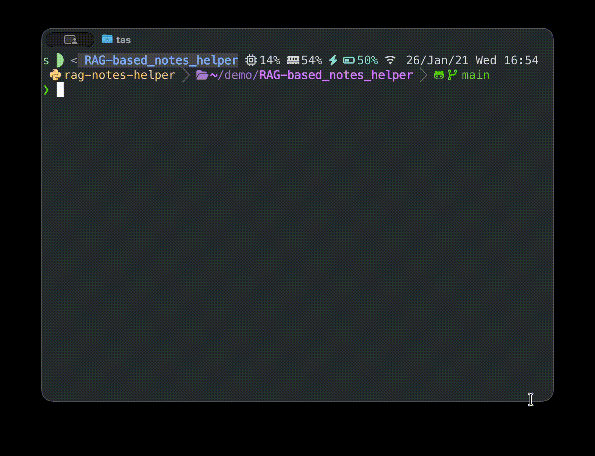
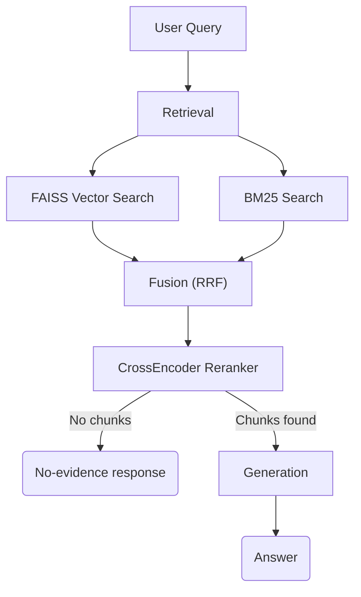
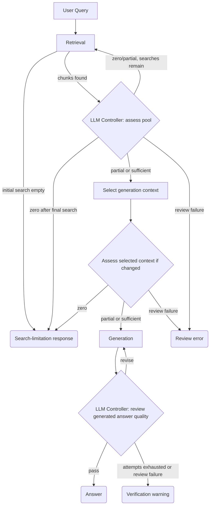

# RAG-based Notes Helper


A local-first Retrieval-Augmented Generation (RAG) application for asking questions about your notes. It retrieves relevant passages and uses a configurable LLM to generate answers, with optional source citations.

Use it from the CLI or an interactive REPL, or connect a coding assistant through a local read-only MCP search tool.

<p align="center">
  <a href="docs/demo/demo.mp4">
    
  </a>
</p>

[Get started →](#quick-start)

## Contents

- [Highlights](#highlights)
- [Quick Start](#quick-start)
- [Usage](#usage)
- [Why This Project](#why-this-project)
- [Architecture](#architecture)
- [Evaluation](#evaluation)
- [Project Structure](#project-structure)
- [Testing](#testing)
- [Limitations](#limitations)
- [License](#license)

## Highlights

- **Hybrid retrieval:** Combine FAISS Vector search and BM25 with Reciprocal Rank Fusion (RRF), then rerank candidates with a CrossEncoder.
- **Two workflows:** Use Classic RAG for one search or Agentic RAG for bounded evidence recovery and answer review.
- **Source visibility:** Show source files with CLI answers, or inspect source paths and line ranges in MCP search results.
- **Local MCP search:** Give a coding assistant access to ranked note chunks through a read-only `search_notes` tool.
- **Isolated evaluation:** Measure retrieval and answer quality against a reviewed fixture without using your runtime notes or index.

## Quick Start

**Requirements:**

- Python 3.11+
- [uv](https://docs.astral.sh/uv/)
- [Ollama](https://ollama.com/download) installed and running, or an API key for a supported remote provider

1. Clone the repository and install dependencies:

   ```bash
   git clone https://github.com/StevenHuang41/RAG-based_notes_helper.git
   cd RAG-based_notes_helper
   uv sync
   cp .env.example .env
   ```

2. If using the default Ollama configuration, download the `gemma4:e2b` model:

   ```bash
   ollama pull gemma4:e2b
   ```

   To use OpenAI, Gemini, OpenRouter, or Hugging Face instead, comment out the Ollama block in `.env`, enable the chosen provider, and set its model and API key.

   See [Configuration](#configuration).

   Remote LLM providers receive the selected note passages.

3. Add `.md`, `.txt`, `.pdf`, or `.py` notes to `data/`. You can also use the included `data/notes_helper.md` to try the project.

4. Ask a question:

   ```bash
   uv run rag-app "What can Notes Helper do?" --citations
   ```

   The first query builds an index if one does not exist and may download embedding and reranking models. Check the cited source files: retrieval
   and generated answers can be incomplete or incorrect.

## Usage

### CLI and REPL

```bash
# Ask a question with Classic RAG
uv run rag-app "What is RAG?" --citations

# Use Agentic RAG
uv run rag-app "What is RAG?" --agentic --citations

# Start an interactive session
uv run rag-app --repl
uv run rag-app --repl --agentic
```

Classic RAG is the default. Agentic RAG can perform additional searches and review its answer.

In the REPL, use:

| Command | Action |
|---|---|
| `:help` | Show all commands |
| `:citations` | Toggle source citations |
| `:stream` | Toggle streaming for the current session |
| `:config` | Show configuration and the current streaming and citation modes |
| `:update` | Update the index after notes change |
| `:quit` | Exit the REPL |

Alternatively, activate the environment to run `rag-app` directly:

```bash
# macOS / Linux
source .venv/bin/activate
rag-app "What is RAG?" --citations
```

Run `deactivate` when you are done.

### Updating the Index

An existing index is reused and is not automatically refreshed when notes change. Update it before querying, or rebuild it from scratch:

```bash
uv run rag-app --update     # update changed files
uv run rag-app --reindex    # rebuild index from scratch
```

In the REPL, use `:update` or `:reindex` to refresh the index without restarting. Use `:sources` to list indexed files.

### Configuration

Edit `.env` to change the provider, model, or retrieval settings. See [.env.example](.env.example) for all available example settings.

| Setting | Purpose |
|---|---|
| `LLM_PROVIDER` / `LLM_MODEL` | Select the LLM backend and model |
| `LLM_MAX_CHUNKS` | Limit the chunks sent to answer generation |
| `VECTOR_TOP_K` / `BM25_TOP_K` | Limit candidates from each search method |
| `FUSION_TOP_K` | Limit candidates after RRF fusion |
| `AGENTIC_MAX_SEARCH_ATTEMPTS` | Limit total searches per Agentic query |
| `AGENTIC_MAX_ANSWER_ATTEMPTS` | Limit total answer attempts per Agentic query |

Agentic attempt limits include the first attempt, default to three, and allow values from one to five.

After editing `.env`, restart the REPL to load the new settings. To inspect the loaded configuration, use `:config` in the REPL or:

```bash
uv run rag-app --config
```

In the REPL, `:stream` and `:citations` change the current session's output immediately without editing `.env`. Use `:config` to see their current state.

### Local MCP search

The local MCP server exposes the read-only `search_notes` tool over stdio.
It returns ranked chunks with source paths and line ranges; the connected coding agent uses them to answer. The server does not generate answers.

The server refreshes its index at startup. Restart it after changing notes or configuration. `top_k` defaults to and is capped by `LLM_MAX_CHUNKS`.
Returned passages enter the agent's context and may be sent to its model provider.

#### Codex app

1. Complete [Quick Start](#quick-start), including `uv sync` and a valid `.env`, and add notes to `data/`. The MCP server validates the LLM configuration at startup.

2. With the Codex CLI installed, run these commands in a terminal from the repository directory:

   ```bash
   codex mcp add rag_notes -- "$(command -v uv)" --directory "$PWD" run rag-mcp-server
   codex mcp list
   ```

   Confirm `rag_notes` appears in the list. This registers the server; it does not verify that a search succeeds. Codex starts the server when needed, so you do not need to run it separately.

3. Start a new **local** Codex app session and try:

   ```text
   Use the rag_notes search_notes tool to find what my notes say about RAG.
   Return at most 3 chunks, cite their source paths and line ranges, and answer only from those chunks.
   ```

   Inspect the tool call and returned chunks to confirm the search ran and the answer uses their evidence. An empty result means no chunks were returned for that search; a tool error indicates a failure.

If the server times out during startup, add `startup_timeout_sec = 120` to
the existing `[mcp_servers.rag_notes]` section in `~/.codex/config.toml` and
start a new session. Initial indexing and model downloads can take longer.

See the [Codex MCP documentation](https://developers.openai.com/codex/mcp) and the [technical guide](docs/guide.md#local-mcp-search) for troubleshooting.

### Docker

#### Docker run

Run the published image without cloning the repository. This example
requires Docker Desktop and Ollama running on the host.

1. Pull the image:

   ```bash
   docker pull ghcr.io/stevenhuang41/rag-based-notes-helper:latest
   ```

2. Download the model on the host and add your notes to a local `data/`
   directory:

   ```bash
   ollama pull gemma4:e2b
   mkdir -p data
   ```

   Add at least one non-empty `.md`, `.txt`, `.pdf`, or `.py` note to `data/` before starting; otherwise, the application cannot build the index and will fail at startup.

3. Start the interactive REPL:

   ```bash
   docker run --rm -it \
     -e LLM_PROVIDER=ollama \
     -e LLM_MODEL=gemma4:e2b \
     -e OLLAMA_BASE_URL=http://host.docker.internal:11434 \
     -v "$(pwd)/data:/app/data" \
     ghcr.io/stevenhuang41/rag-based-notes-helper:latest \
     --repl
   ```

   Type a question at the prompt, or use `:help` to see available commands.
   Use `:quit` to exit.

This example persists notes in `data/`. The index, logs, and downloaded embedding and reranking models remain in the container and are removed when it exits. Linux Docker Engine may require additional host networking setup
to reach Ollama.

#### Docker Compose

For repeated use, download the Compose file and create a configuration:

```bash
mkdir rag-notes-helper
cd rag-notes-helper

curl -L -o docker-compose.yml \
  https://raw.githubusercontent.com/StevenHuang41/RAG-based_notes_helper/main/docker-compose.yml

mkdir -p data storage logs hf_cache
```

Create a `.env` file and add the following variables for Ollama running on
the host with Docker Desktop:

```bash
# .env
LLM_PROVIDER=ollama
LLM_MODEL=gemma4:e2b
OLLAMA_BASE_URL=http://host.docker.internal:11434
```

Ensure Ollama is running and the model is available on the host. Add at
least one non-empty `.md`, `.txt`, `.pdf`, or `.py` note to `data/`, then run:

```bash
docker compose pull rag-app
docker compose run --rm rag-app --repl
```

Compose uses the published GHCR image and mounts `data/`, `storage/`,
`logs/`, and `hf_cache/` from the host, so they persist between runs.

## Why This Project

Personal notes change frequently. RAG keeps them as an external knowledge
source, so the application can retrieve relevant passages without
fine-tuning a model whenever notes change. The retrieved sources can also
be inspected alongside the answer.

## Architecture

Both workflows index notes from `data/` as chunks with embeddings and source metadata. Their shared Hybrid retrieval combines FAISS Vector search and BM25 with RRF, then reranks candidates with a CrossEncoder.

### Classic RAG

Classic RAG performs one retrieval search and generates an answer from the selected context.
If the search returns no chunks, it returns a no-evidence response without calling the answer model.



### Agentic RAG

Agentic RAG uses an LLM controller to assess evidence, plan additional
searches, and review answer candidates. Search and Answer attempts have
independent limits, each including the first attempt.



The controller may adjust the query or thresholds for another Search.
After retrieval, the workflow selects context for generation.
Answer revisions use the same context and do not reopen retrieval.

If the initial Search returns no chunks, either workflow returns a search-limitation message suggesting a revised question; Agentic skips controller review and additional searches.
After Search, zero evidence returns a fixed no-related-information response. The controller checks the selected generation context when selection removes chunks; only partial or sufficient evidence reaches Answer. A failed Retrieval review returns a workflow error without generation.

## Evaluation

Evaluation uses fictional notes and reviewed QA set to evaluate Classic and Agentic RAG. The dataset is designed for regression testing, not as a representative benchmark.

- `evals/notes/`: fictional notes used as the evaluation corpus.
- `evals/qa/notes_qa.json`: questions, reference answers, and expected evidence linked to the notes.
- `evals/results/`: generated reports, ignored by Git.

Each run builds a temporary index from the evaluation notes. It does not
read or modify your `data/` or `storage/`.

```bash
# Evaluate all Classic RAG cases
uv run rag-app --eval

# Evaluate all Agentic RAG cases
uv run rag-app --eval --agentic

# Evaluate the same sample with each workflow
uv run rag-app --eval --sample 5 --seed 42
uv run rag-app --agentic --eval --sample 5 --seed 42
```

Evaluation requires a source checkout with development dependencies.
If you change the evaluation notes, review and update any affected
line-anchored evidence in the QA set.

### LLM judge

Ragas uses an LLM judge for applicable answer-quality metrics.
By default, it uses the same provider and model as answer generation.

To use a different judge, set both variables in `.env`:

```bash
LLM_EVAL_PROVIDER=gemini
LLM_EVAL_MODEL=gemini-2.5-flash
LLM_EVAL_API_KEY=your-gemini-api-key
```

A different remote provider requires `LLM_EVAL_API_KEY`.
For the same provider, the judge reuses `LLM_API_KEY` unless an evaluation key is set.
Ollama does not require an API key.

### Reports

Each run saves `README.md`, `results.json`, and `run.log` in a timestamped directory under `evals/results/`.
The report includes line-grounded Recall, Precision, and NDCG, Ragas diagnostics for applicable answers, and workflow failure or degradation details.
Ragas scores depend on the configured judge and are not guarantees of correctness.
Provider calls may incur costs.

## Project Structure

```text
.
├── data/                     # Runtime notes, including an example
├── docs/                     # Architecture decisions, agent guides, and demo
├── evals/
│   ├── notes/                # Evaluation corpus
│   ├── qa/                   # Reviewed QA ground truth
│   └── results/              # Generated reports (ignored by Git)
├── src/rag_notes_helper/
│   ├── cli.py                # CLI entry point
│   ├── mcp_server.py         # Local MCP search server
│   ├── core/                 # Configuration
│   ├── eval/                 # Evaluation workflows and reports
│   └── rag/                  # Ingestion, retrieval, generation, and LLM providers
├── tests/                    # pytest tests
├── .env.example              # Example configuration
└── docker-compose.yml        # Containerized CLI
```

Runtime index and log directories such as `storage/` and `logs/` are local and ignored by Git.

## Testing

Run the test suite from the project root:

```bash
uv run pytest
```

Tests cover application components and offline workflow behavior. Passing tests does not establish live-provider or MCP-client behavior. The CI workflow runs pytest; the CD workflow builds and publishes the container image.

## Limitations

- Retrieval and answer quality depend on the notes, chunking, models, and provider; citations are evidence to inspect, not a guarantee of correctness.
- An existing index must be updated after notes change. MCP refreshes it at server startup.
- Agentic Search and Answer attempts are bounded. REPL conversation history is temporary and is not evidence.
- Remote providers require credentials and receive the context needed for their model calls. MCP results may also be sent to the connected assistant's provider.

## License

This project is licensed under the [MIT License](LICENSE).
