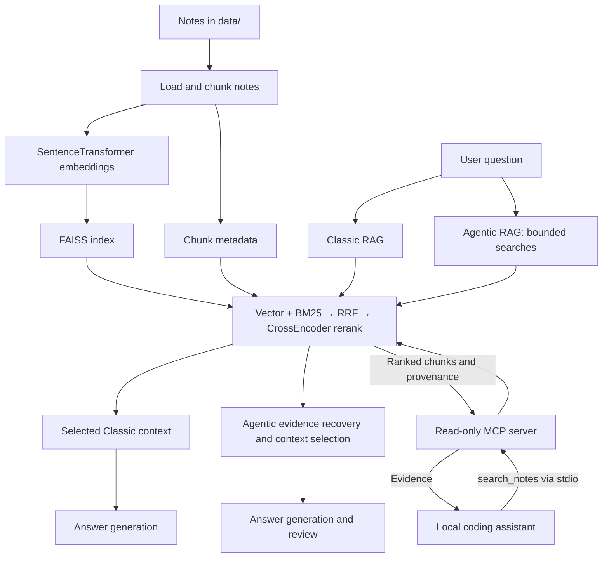

# Technical guide

Detailed architecture, evaluation, MCP setup, and configuration for [RAG-based Notes Helper](../README.md).

## Architecture



The local MCP path returns retrieval evidence to the coding assistant; the RAG application's answer-generation workflow is not invoked by the MCP server.

---

## How It Works

1. **Configuration validation**
   - The CLI reads `.env` through Pydantic Settings.
   - Required provider/model/key fields are validated before runtime.

2. **Document loading**
   - Files in `data/` are scanned for supported extensions.
   - Loaders normalize source content into text streams.

3. **Chunking**
   - Documents are split into overlapping chunks.
   - Chunk size and overlap are controlled by `CHUNK_SIZE` and `CHUNK_OVERLAP`.

4. **Indexing**
   - Chunks are embedded with `sentence-transformers/all-MiniLM-L6-v2` by default.
   - Embeddings are normalized and stored in a FAISS index.
   - Chunk text and source metadata are stored outside the vector index.

5. **Retrieval**
   - The user query is embedded with the same embedding model for Vector search.
   - BM25 searches the indexed chunk text independently of the embedding model.
   - Vector matches below `VECTOR_MIN_SCORE` are filtered. BM25 candidates below `BM25_MIN_SCORE_RATIO` times that query's highest positive BM25 score are filtered; the ratio is query-relative rather than a cross-query score comparison.
   - Reciprocal Rank Fusion combines both ranked lists into the configured fusion candidate list. A CrossEncoder then reranks the fused candidates.

6. **Workflow selection and answer generation**
   - Classic RAG sends one retrieval result to answer generation.
   - Agentic RAG uses a LangGraph StateGraph with two phases: bounded evidence recovery, then generation and same-context Answer review. Each Search appends original chunks to a pool deduplicated by source/chunk identity, preserving first-seen order and all Search provenance. The controller judges the full pool against the original question as zero, partial, or sufficient evidence; no separate round coverage state is maintained.
   - The first Search uses the original question and configured thresholds. For zero/partial evidence, later searches may rewrite the query and adjust Vector/BM25 thresholds within `[0, 1]`, while configured top-k, models, and generation limits remain unchanged. Normal Retrieval stops at sufficient evidence or the Search cap. Coverage and stop reason are separate: exhausted searches do not prove corpus absence.
   - Search and Answer total-attempt limits are independently configurable, defaulting to three each with an allowed range of one through five. Each includes the first attempt. Controller validation retries consume neither budget. Answer review cannot reopen Retrieval or expand its selected context.
   - Once Retrieval finishes, pools larger than `LLM_MAX_CHUNKS` are reranked against the original question and reduced to top-k. Smaller pools retain first-seen order without final reranking. If selection removes evidence, the controller separately assesses the exact selected context before generation; an unchanged pool reuses the pool assessment.
   - A final pool or selected context assessed as zero evidence returns a fixed no-related-information outcome without generation. Only partial or sufficient selected context reaches Answer. Accepted answers can be full, partial with explicit gaps, or abstentions. Unsupported claims or undisclosed gaps trigger revisions with the same context. Candidates remain buffered until accepted; revision exhaustion, empty generation, or failed review returns a fixed warning without exposing a rejected candidate. With `STREAM=true`, the CLI displays the accepted Agentic answer in chunks after review; Classic streams during generation.
   - If the initial Search returns no chunks, both modes immediately return a deterministic search-limitation message suggesting a revised question, without Answer generation; Agentic also skips controller review and additional searches. A later empty Search does not erase earlier chunks.
   - Invalid Retrieval decisions receive one validation retry. Persistent invalidity or provider failure returns a workflow error without Answer generation; unknown coverage is not treated as zero evidence. User-facing warnings avoid internal failure codes, while evaluation retains sanitized causes.
   - Retrieved chunks are inserted into the LLM prompt as context.
   - The answer can include source citations.
   - REPL mode keeps the loaded index available for faster repeated queries.

---

## Evaluation

From a source checkout with development dependencies installed, `--eval` evaluates Classic RAG and `--agentic --eval` evaluates Agentic RAG against the fixed evaluation corpus under `evals/notes/` and the reviewed QA set at `evals/qa/notes_qa.json`. Each run builds a temporary index and does not read or modify the user's `data/` or `storage/` directories:

```bash
uv run rag-app --eval
uv run rag-app --eval --sample 5 --seed 42
uv run rag-app --agentic --eval --sample 5 --seed 42
```

Each run writes `README.md`, `results.json`, and `run.log` under a local-time, Taipei timestamped directory in `evals/results/`. These generated reports are ignored by Git. When stderr is a terminal, evaluation shows a progress bar for case execution and RAGAS metric stages. Run metadata records the selected workflow, sampling settings, and selected case IDs. Sample selection is uniform without replacement; cases run in evaluation-corpus order. The same corpus, QA set, sample count, and seed select the same cases. Without a seed, a sampled run may select a different subset each time. A seed without `--sample` still runs the full QA set. `--sample` must be a positive integer no larger than the QA set size.

The evaluation corpus and QA set are a fixed regression set, not a statistically representative benchmark. A small sample can omit categories; inspect the selected case IDs and category counts in the report. Evaluation logs use case IDs and do not include query or note text. Results keep answerability, reason-code, response-origin, workflow-error, Retrieval evidence, and line-grounded Recall/Precision/NDCG checks separate from model-based RAGAS diagnostics. Classic generated answers use free-form wording and have unknown answerability; Agentic uses Answer review decisions. Unknown answerability does not by itself exclude generated answers from applicable RAGAS metrics.

Accepted generated full answers, partial answers, and abstentions enter per-metric Ragas applicability checks, when their other metric requirements are met. Deterministic empty-pool/rephrasing/warning outcomes and rejected candidates do not enter accepted-final-answer means. Answer Correctness requires the reviewed Reference answer; Faithfulness and Context Utilization additionally require the exact Final generation context. Each metric records `scored`, `unavailable`, or `failed` with applicable/scored counts and reasons. RAGAS scores are provider-dependent observations, not pass/fail guarantees.

The report distinguishes artifact process status from workflow outcome. A successfully written run containing query-level failures or degradation is `completed` with workflow outcome `completed_with_errors`; it reports failure/degradation counts and reliability independently of answer quality. Agentic query details compare accumulated and selected pools in two metadata-only tables, even when final reranking is skipped, then show actual generation context separately. Per-query Search registries retain effective thresholds and every executed Search. Final context evidence metrics use only the exact context sent to generation. Real Retrieval review, final pool rerank, Answer review, and judge costs remain distinguishable. Token counts are provider-reported; unavailable values remain unavailable, while character counts are recorded separately.

The QA set covers direct lookup, multi-hop integration, unanswerable questions, and ambiguous questions. Evaluation always uses this reviewed evaluation corpus and isolated synthetic index; it never evaluates a user's `data/` directory or persistent `storage/` snapshot. If the corpus changes, review and update any affected line-anchored QA evidence in the same change; validation rejects stale evidence rather than rewriting it automatically.

`--eval` is a repository development command. The evaluation code, evaluation assets, and RAGAS development dependencies are not included in the runtime wheel. In a source checkout, use an editable development install to run this command.

---

---

## Local MCP search

The `rag-mcp-server` command exposes one read-only `search_notes` tool over local stdio. It refreshes the runtime index from `data/` at startup, runs the shared Hybrid retrieval pipeline, and returns ranked chunks with relative source paths, line ranges, and ranking provenance. Restart the server to guarantee later note changes are indexed. It does not generate an answer.

The optional `top_k` defaults to `LLM_MAX_CHUNKS` and is capped at that value. A client can request fewer chunks for a single search without changing the configuration. The limit is loaded when the server starts, so restart it after changing `.env`. It is a maximum: upstream Vector, BM25, and fusion limits and available evidence can yield fewer chunks. Source notes and the index remain local, but returned evidence enters the connected assistant's context and may be sent to its model provider.

### Set up a local client

Install from source and configure the project as described in [Quick start](../README.md#quick-start). Add your notes under `data/`. The application currently validates `LLM_PROVIDER` and `LLM_MODEL` when the server starts, even though MCP search does not invoke an answer-generation model; choose a valid provider configuration in `.env`. Embedding and reranking models must be available locally or downloadable on first use. The client starts the server itself; there is no need to launch a separate terminal for `rag-mcp-server`.

From the repository directory, note the absolute paths shown by these commands:

```bash
pwd
command -v uv
```

Use those paths below. The client launches the local process with your user permissions; it has no network listener or OAuth layer. When configuring a client, allow enough startup time for indexing and first-time model downloads.

**Codex app / CLI**

From this repository directory, register the server with the Codex CLI. `--directory` selects this checkout even when you use Codex from another directory:

```bash
codex mcp add rag_notes -- "$(command -v uv)" --directory "$PWD" run rag-mcp-server
codex mcp list
```

Set `startup_timeout_sec = 120` in the resulting `rag_notes` entry in `~/.codex/config.toml`, then start a new local Codex app session and check that `rag_notes` is available. Alternatively, add the following entry directly, replacing both paths with the absolute paths from above:

```toml
[mcp_servers.rag_notes]
command = "/absolute/path/to/uv"
args = ["--directory", "/absolute/path/to/RAG-based_notes_helper", "run", "rag-mcp-server"]
startup_timeout_sec = 120
```

Use one registration method, not both. A Codex app session was verified against the sample notes: `search_notes` returned three chunks with provenance for `top_k=3`, and Codex answered from them. The local test used `OMP_NUM_THREADS=1`; see the troubleshooting note below. See [Codex MCP configuration](https://developers.openai.com/codex/mcp) for current options.

**Claude Code**

From this repository directory, register a local stdio server:

```bash
claude mcp add --transport stdio rag_notes -- "$(command -v uv)" --directory "$PWD" run rag-mcp-server
claude mcp get rag_notes
```

Start Claude Code in the same project and use `/mcp` to inspect its server status. This configuration follows [Claude Code MCP documentation](https://code.claude.com/docs/en/mcp); it has not been verified with an actual Claude Code tool call.

### Search and verify

In your coding assistant, try:

```text
Use the rag_notes search_notes tool to find what my notes say about RAG.
Return at most 3 chunks, cite their source paths and line ranges, and answer only from those chunks.
```

Inspect the actual tool call and response to confirm that `top_k` is 3 and that each result includes text, relative source path, chunk ID, line range, and ranking provenance. Then compare the answer and citations with the returned evidence. The assistant decides whether to call the tool and how to use its results; instructions alone do not guarantee a tool call or an evidence-grounded answer. An empty result means no chunks were returned for that search, while a tool error indicates a failure.

If the server does not connect, check that the absolute `uv` and repository paths exist, dependencies are installed, and the project's `.env` is valid. Inspect the client's MCP logs or server stderr for configuration, model download, and index errors; stdout is reserved for the MCP protocol. The first startup can take longer while building the index or downloading models. Restart the server after modifying notes.

On macOS, if the server exits with a segmentation fault (exit 139) during indexing or embedding, try setting `OMP_NUM_THREADS=1` in the client-launched server environment. For Codex, add this to the existing `rag_notes` entry in `~/.codex/config.toml`, then start a new session:

```toml
[mcp_servers.rag_notes.env]
OMP_NUM_THREADS = "1"
```

A local macOS ARM / Python 3.14 test reproduced the crash when FAISS and SentenceTransformer were used together; limiting OpenMP threads allowed the MCP search to complete. The underlying native failure is not yet identified. This setting can affect performance and is only a troubleshooting option.

---

---

## Configuration

The application reads configuration from `.env`.

Minimal remote-provider configuration:

```text
LLM_PROVIDER=gemini
LLM_MODEL=gemini-2.0-flash
LLM_API_KEY=your-api-key
```

Minimal Ollama configuration:

```text
LLM_PROVIDER=ollama
LLM_MODEL=llama3.1
LLM_API_KEY=not-used
OLLAMA_BASE_URL=http://localhost:11434
```

Minimal OpenRouter configuration:

```text
LLM_PROVIDER=openrouter
LLM_MODEL=provider/model
LLM_API_KEY=your-openrouter-api-key
```

Use an OpenRouter model identifier in `provider/model` form. See the [OpenRouter quickstart](https://openrouter.ai/docs/quickstart) for account and model setup.

Ragas evaluation uses the generation provider and model as its judge by default. To select a different judge, set both `LLM_EVAL_PROVIDER` and `LLM_EVAL_MODEL`. `LLM_EVAL_PROVIDER` accepts `hf`, `openai`, `ollama`, `gemini`, or `openrouter`. A same-provider judge reuses `LLM_API_KEY` unless `LLM_EVAL_API_KEY` is set; a different remote provider requires `LLM_EVAL_API_KEY`. Ollama judges do not require an evaluation API key.

For example, use OpenRouter for answers and a different provider for evaluation:

```text
LLM_PROVIDER=openrouter
LLM_MODEL=provider/answer-model
LLM_API_KEY=your-openrouter-api-key

LLM_EVAL_PROVIDER=gemini
LLM_EVAL_MODEL=gemini-2.5-flash
LLM_EVAL_API_KEY=your-gemini-api-key
```

If only one of `LLM_EVAL_PROVIDER` or `LLM_EVAL_MODEL` is set, configuration fails instead of pairing it with an unintended default.

Common settings:

| Variable | Purpose | Default / example |
|---|---|---|
| `LLM_PROVIDER` | LLM backend | `hf`, `gemini`, `openai`, `openrouter`, `ollama` |
| `LLM_MODEL` | Model name for selected provider | `gemini-2.0-flash` |
| `LLM_API_KEY` | API key for remote providers | required except Ollama |
| `LLM_EVAL_PROVIDER` | Optional Ragas judge provider; defaults to `LLM_PROVIDER` | `hf`, `openai`, `ollama`, `gemini`, `openrouter` |
| `LLM_EVAL_MODEL` | Optional Ragas judge model; defaults to `LLM_MODEL`; set with `LLM_EVAL_PROVIDER` | provider-specific model name |
| `LLM_EVAL_API_KEY` | Optional judge key; required for a different remote judge provider | `your-evaluation-provider-api-key` |
| `LLM_MAX_CHUNKS` | Maximum selected chunks sent to Answer generation and default and maximum chunks returned by each MCP search | `5` |
| `LLM_MAX_TOKENS` | Maximum output tokens for each generation | `1024` |
| `LLM_TEMPERATURE` | Generation temperature | `0.1` |
| `CHUNK_SIZE` | Chunk size for ingestion | `1000` (code default); `200` in `.env.example` |
| `CHUNK_OVERLAP` | Chunk overlap | `200` (code default); `50` in `.env.example` |
| `VECTOR_TOP_K` | Human-configured maximum candidates returned by Vector search; Agentic actions cannot change it | `30` |
| `BM25_TOP_K` | Human-configured maximum candidates returned by BM25 search; Agentic actions cannot change it | `20` |
| `FUSION_TOP_K` | Human-configured maximum candidates returned after RRF fusion; Agentic actions cannot change it | `15` |
| `VECTOR_MIN_SCORE` | Starting Vector similarity threshold in `[0, 1]`; later Agentic searches may adapt it | `0.2` (code default); `0.3` in `.env.example` |
| `BM25_MIN_SCORE_RATIO` | Starting query-relative BM25 threshold ratio in `[0, 1]`; later Agentic searches may adapt it | `0.0` |
| `CROSS_ENCODER_MODEL` | Sentence Transformers model used to rerank fused candidates | `cross-encoder/ms-marco-MiniLM-L6-v2` |
| `AGENTIC_MAX_SEARCH_ATTEMPTS` | Maximum total Retrieval searches per Agentic query, including the original search | `3` (range `1`–`5`) |
| `AGENTIC_MAX_ANSWER_ATTEMPTS` | Maximum total Answer generations per Agentic query, including the first generation | `3` (range `1`–`5`) |
| `STREAM` | Stream model output where supported | `true` |

Use `FUSION_TOP_K` and `VECTOR_MIN_SCORE` in place of the former `TOP_K` and `MIN_RETRIEVAL_SCORE` environment variables; the old names are no longer accepted.

The application retains the most recent five complete REPL turns for intent context without trimming them by a local token estimate. `LLM_MAX_TOKENS` controls the separate output limit. The retired `LLM_CONTEXT_WINDOW_TOKENS` setting is ignored if it remains in an existing environment file.

Agentic sends the complete accumulated chunks pool to Retrieval review against the original question after each Search. Once Retrieval stops, an oversized pool is reranked and at most `LLM_MAX_CHUNKS` chunks are selected for Answer generation; those chunks remain intact through Answer review and revisions. Model and deployment capacity still applies. If a provider rejects review input, the workflow reports a review error and retains the pool for audit without generating an answer; Answer generation or Answer review failure returns the existing safe warning. The application does not provision provider context capacity or guarantee that a provider consumes every submitted token.

---
